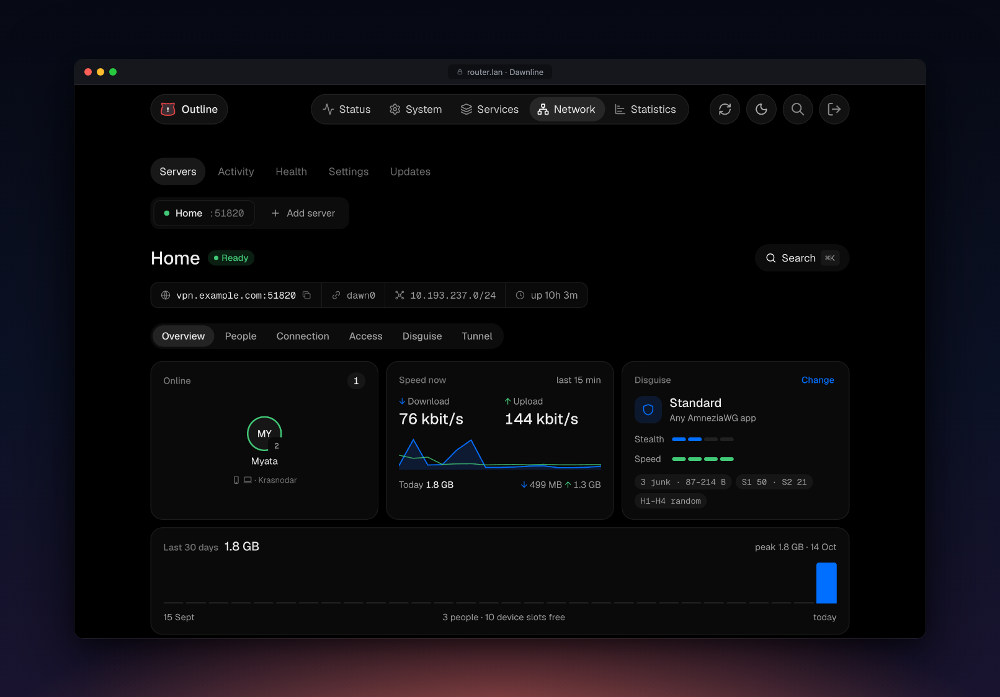
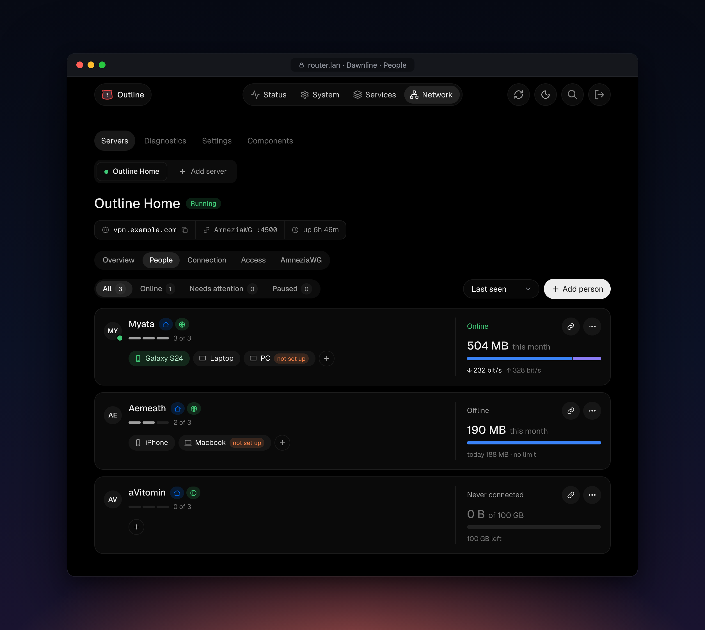
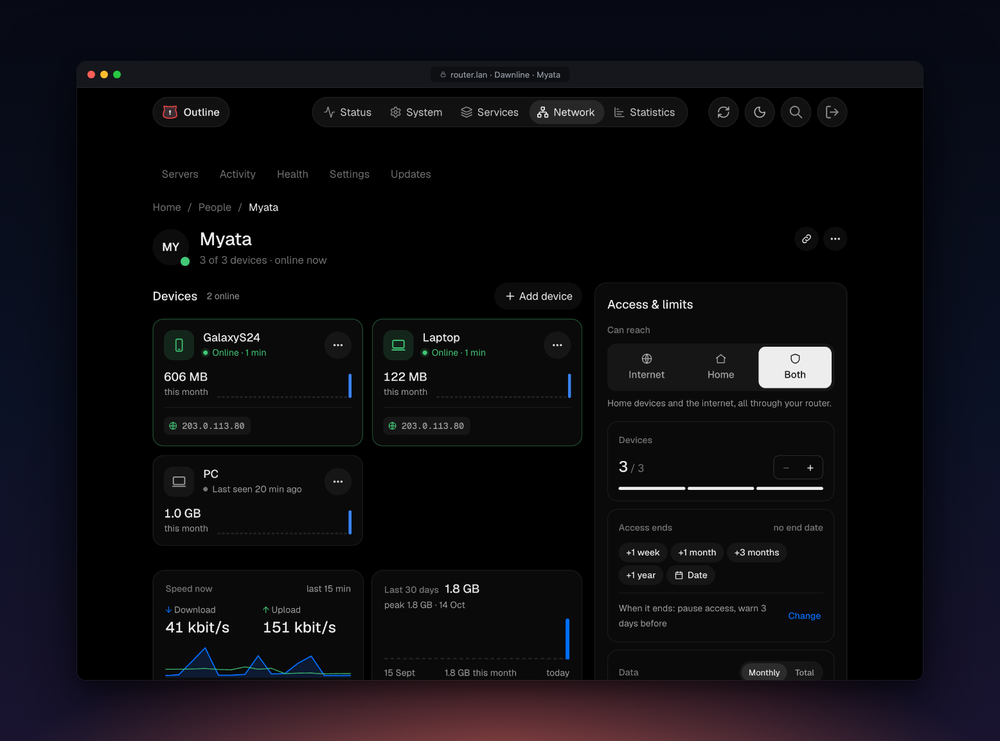
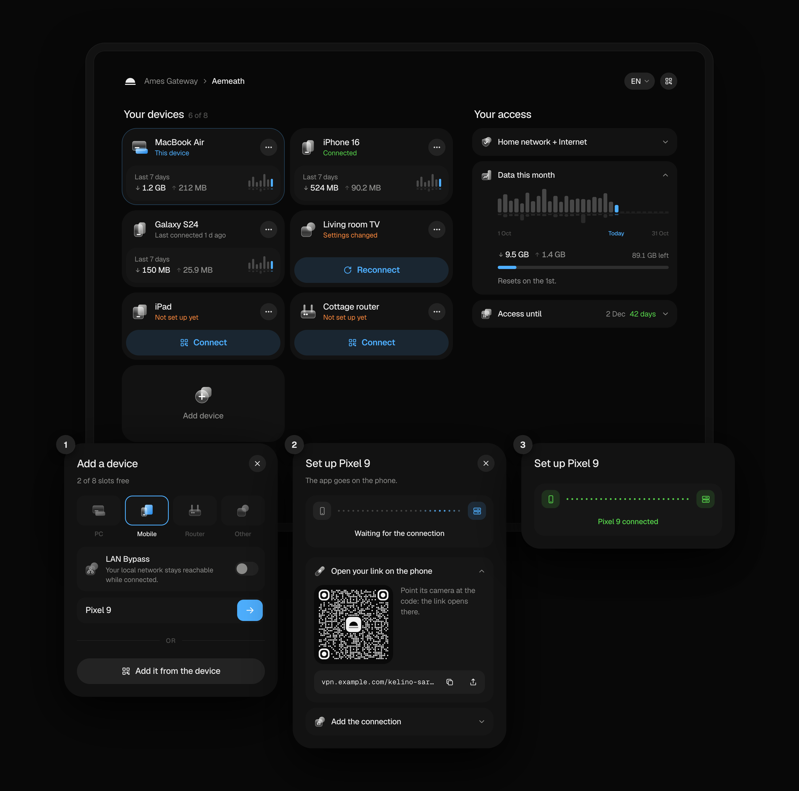
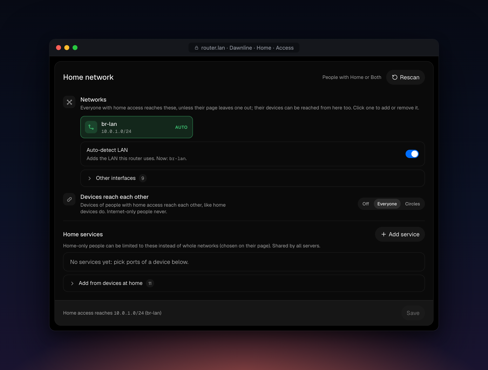
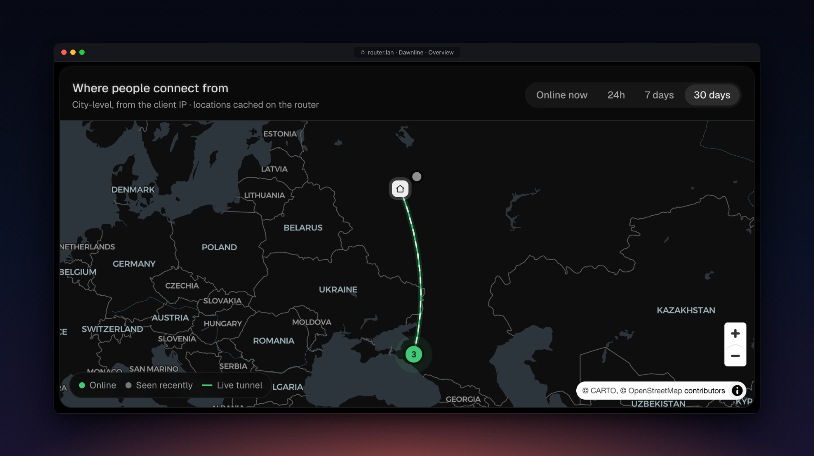

# Dawnline

[](https://github.com/tickcount/luci-app-dawnline/actions/workflows/ci.yml)
[](https://github.com/tickcount/luci-app-dawnline/actions/workflows/build.yml)

Your OpenWrt router as a private VPN for the people you choose.

Dawnline runs an [AmneziaWG](https://docs.amnezia.org/) server on the router
and gives every person a personal link. They open it, add their own devices
(up to the limit you set) and connect with AmneziaVPN or AmneziaWG. You decide
what each person may reach: the home network, the internet, or both.

Dawnline is the successor of [Liminal](https://github.com/tickcount/openwrt-liminal):
the same idea rebuilt around people instead of peers, with a personal portal,
limits, live traffic and a LuCI admin that follows a modern design.



| People | A person |
|---|---|
|  |  |

| Personal portal | Home network access |
|---|---|
|  |  |



## Features

- **People, not peers.** One card per person with device chips, live status,
  traffic, end date and data limit. Add a person, send them the link or the
  invite card (QR code), and they do the rest.
- **Personal portal.** Every person gets a link made of three words
  (`https://vpn.example.com/kamiro-telosu-bavine`). The link is the key: no
  accounts, no sessions, and a new link locks the old one out at once. People
  add, rename and remove their devices and get each one as a QR code,
  "Open in AmneziaVPN" (`vpn://`), a key or a `.conf` file. They cannot change
  access or limits. Links work on the portal's own port with a Let's Encrypt
  certificate (via ACME), several addresses at once (a Cloudflare-proxied name,
  a plain IP), the same link at home, and wrong links can redirect to your
  website. Behind Cloudflare, pick a port it proxies (2053, 2083, 2087, 2096 or
  8443).
- **Access per person**, enforced in an `inet dawnline` nftables table on the
  tunnel interface: home network only, internet only, or both, and optionally
  only some home networks or home services (picked from the devices the router
  sees over DHCP). Devices of different people reach each other never, always,
  or within circles (family sees family, guests see guests). "Who reaches what"
  sums up the rules and "Check access" walks them step by step for a device
  and an address.
- **Limits.** End dates (pause, keep, or remove devices when they pass), monthly
  or total data limits, allowed hours, pause anyone. Devices
  drop off the tunnel at once (`awg syncconf`, no interface restart).
- **Disguise presets** for AmneziaWG obfuscation (junk packets,
  header and padding parameters), with what each preset needs from the apps.
- **Internet like a home device.** Tunnel clients' internet traffic enters the
  router from the LAN, through a small network namespace on the LAN bridge
  (needs `kmod-veth`). Whatever handles LAN traffic on the router (proxies, DPI
  bypass, DNS filters, the `lan` zone) handles VPN clients too, with no
  per-tool integration.
- **Overview.** Who is online with what, speed now, today and the last 30 days,
  and a map of where people connect from (city level).
- **Diagnostics.** Health checks with one-click fixes, including the ones that
  matter for reaching the portal from outside (DNS, port forwards, reply
  routing behind proxies such as SSClash/Mihomo, certificate coverage). A
  watchdog checks the tunnels, access rules, portal, resolver and LuCI link
  every minute and repairs them on its own (a cron job looks after the agent
  itself). One log holds people's activity and the service log: tunnel starts
  and stops with netifd's reasons, repairs and errors (`dawnline log` on the
  router).
- **Updates.** Dawnline itself, AmneziaWG builds for your firmware (choose
  between [Slava-Shchipunov](https://github.com/Slava-Shchipunov/awg-openwrt)
  and [2Grey](https://github.com/2Grey/awg-openwrt), AmneziaWG 2.0 or 3.1), and
  the few OpenWrt packages Dawnline adds.
- **Backups** nightly and before risky operations, JSON export/import to move
  to another router.

## Requirements

- OpenWrt **24.10** (opkg, `.ipk`) or **25.12** (apk, `.apk`)
- AmneziaWG (`kmod-amneziawg`, `amneziawg-tools`, `luci-proto-amneziawg`):
  the installer adds a build made for your firmware when it is missing
- About 2 MB of free flash

## Install

On the router:

```sh
sh -c "$(wget -qO- https://raw.githubusercontent.com/tickcount/luci-app-dawnline/main/install.sh)"
```

The installer checks the firmware, the clock, free space and DNS, lets you pick
a release (the latest is the default), shows the plan and asks before it
changes anything. It downloads the Dawnline package for your package manager,
checks it against `sha256sums.txt`, installs AmneziaWG built for your firmware
if it is missing, then installs Dawnline with its dependencies and checks that
LuCI can reach it. Then open **LuCI → Network → Dawnline** and run the setup
wizard.

Before changing anything it saves `/etc/config/{dawnline,network,firewall,dhcp,uhttpd}`
and the service state to `/etc/dawnline/installer-backups/` (the newest three
are kept); if a step fails, it puts them back. Packages are not rolled back: to
return to an older release, run the installer with `--tag`. Everything it does
is logged to `/tmp/dawnline-install.log`.

With options, download it first:

```sh
wget -O /tmp/dawnline-install.sh https://raw.githubusercontent.com/tickcount/luci-app-dawnline/main/install.sh
sh /tmp/dawnline-install.sh --dry-run             # check everything, change nothing
sh /tmp/dawnline-install.sh -y --tag 0.3.1        # a given release, no questions
sh /tmp/dawnline-install.sh --awg grey            # AmneziaWG from 2Grey
```

| Option | |
|---|---|
| `-y`, `--yes` | No questions: the latest release (or `--tag`) and the recommended choices |
| `-n`, `--dry-run` | Check the system, resolve, download and verify the release; change nothing |
| `-v`, `--verbose` / `-q`, `--quiet` | More detail / only warnings and errors |
| `--tag X.Y.Z` | A given release (`sh install.sh 0.3.1` works too) |
| `--awg auto\|slava\|grey\|skip` | Where AmneziaWG comes from when it is missing: [Slava-Shchipunov](https://github.com/Slava-Shchipunov/awg-openwrt), then [2Grey](https://github.com/2Grey/awg-openwrt) (`auto`, the default), only one of them, or not at all (install it later from **Dawnline → Updates**). `DAWNLINE_AWG` does the same |
| `--no-awg` | Same as `--awg skip` |

When GitHub is slow or blocked, the installer retries downloads through
`ghfast.top` and `gh-proxy.com` on its own. To fetch the installer itself
through a mirror:

```sh
sh -c "$(wget -qO- https://cdn.jsdelivr.net/gh/tickcount/luci-app-dawnline@main/install.sh)"
sh -c "$(wget -qO- https://ghfast.top/https://raw.githubusercontent.com/tickcount/luci-app-dawnline/main/install.sh)"
```

By hand, from a [release](https://github.com/tickcount/luci-app-dawnline/releases):

```sh
opkg update && opkg install ./luci-app-dawnline-0.1.0.ipk                 # OpenWrt 24.10
apk update && apk add --allow-untrusted ./luci-app-dawnline-0.1.0.apk     # OpenWrt 25.12
```

**Upgrade** from **Dawnline → Updates**, or run the installer again. Settings,
keys and history are kept, and a backup is made first.

**Remove** on the router:

```sh
sh -c "$(wget -qO- https://raw.githubusercontent.com/tickcount/luci-app-dawnline/main/uninstall.sh)"
```

It backs up the configuration to `/etc/dawnline/backups`, runs Dawnline's own
removal (the same as **Settings → Remove Dawnline from this router**), removes
the package and cleans up what is left. AmneziaWG stays installed, since other
tunnels may use it. After installing Dawnline again, restore the backup in
**Settings → Backups**. With options, download it first:

```sh
wget -O /tmp/dawnline-uninstall.sh https://raw.githubusercontent.com/tickcount/luci-app-dawnline/main/uninstall.sh
sh /tmp/dawnline-uninstall.sh --dry-run
```

| Option | |
|---|---|
| `-y`, `--yes` | Do not ask for confirmation |
| `-p`, `--purge` | Also delete the configuration, keys, history and every backup (`/etc/config/dawnline`, `/etc/dawnline`); no backup is made |
| `--remove-awg` | Also remove AmneziaWG, unless another interface still uses it (`--keep-awg`, the default, keeps it) |
| `-n`, `--dry-run` | Show what would be removed; change nothing |

By hand: **Settings → Remove Dawnline from this router** (keeps a backup), then
`opkg remove luci-app-dawnline` or `apk del luci-app-dawnline`.

## What Dawnline changes on the router

Only objects it created: network interfaces tagged `_dawnline`, firewall
sections named `dawnline_*`, the `inet dawnline` nft table, `/tmp/hosts/dawnline`,
the `dawnline` network namespace with its two veth links (`dlx0`, `dll0`, the
latter a port of the LAN bridge), policy rules for the tunnel interfaces with
one routing table, a second dnsmasq instance on port 5354
(`/var/etc/dawnline-dns.conf`), a cron line for the agent's heartbeat check
and, while the portal is on, a uhttpd instance for it. `dawnline teardown`
removes all of them.

Data lives in `/etc/config/dawnline` (mode 0600, contains private keys) and
`/etc/dawnline/` (usage, events, issued configurations, backups). Live counters
are kept in `/var/run/dawnline` and flushed to flash at most hourly.

## Development

```
package/luci-app-dawnline/
  root/usr/share/ucode/dawnline/   ucode library: model (core), AmneziaWG (awg), apply, live,
                                   ops, view, loop, portal
  root/usr/share/rpcd/ucode/       luci.dawnline RPC object
  root/usr/libexec/dawnline/       agent (usage, limits, presence) and updater
  root/usr/share/dawnline/portal/  portal CGI wrapper and its (minified) assets
  root/usr/bin/dawnline            command line (`dawnline help`)
  htdocs/                          LuCI views and the generated module dawnline/app.js
web/                               TypeScript sources of the admin UI and the portal
build/Dockerfile                   package build with the OpenWrt SDK
scripts/                           build, deploy and check scripts
```

```sh
cd web
npm ci
npm run format        # Prettier
npm run ci            # format check, types, tests, minified bundles

scripts/lint-ucode.py                 # static ucode checks
scripts/check-ucode.sh root@router    # compile every ucode file on a router
scripts/deploy.sh root@router         # install the working tree (backs up configs first)
scripts/build-packages.sh all         # .ipk and .apk with the OpenWrt SDK in Docker
scripts/frame-screenshots.py          # frame docs/screenshots/raw/*.png for this README
```

The web bundles are committed: CI fails when they are out of date. Pushing a
tag `vX.Y.Z` (matching `PKG_VERSION`) builds both packages with the OpenWrt SDK
and publishes a release with `sha256sums.txt`.

## License

[MIT](LICENSE)
