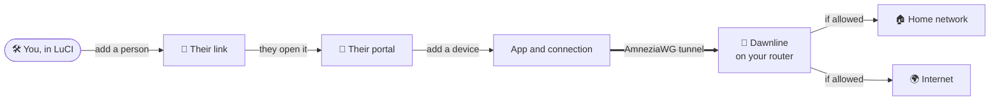

<div align="center">

<picture>
  <source media="(prefers-color-scheme: dark)" srcset="docs/assets/logo-dark.svg">
  
</picture>

<h1>Dawnline</h1>

**Your OpenWrt router as a private VPN for the people you choose.**

<a href="https://github.com/tickcount/luci-app-dawnline/releases/latest"><picture><source media="(prefers-color-scheme: dark)" srcset="https://shieldcn.dev/github/release/tickcount/luci-app-dawnline.svg?variant=secondary&font=geist&mode=dark"></picture></a>
<a href="https://github.com/tickcount/luci-app-dawnline/actions/workflows/ci.yml"><picture><source media="(prefers-color-scheme: dark)" srcset="https://shieldcn.dev/github/ci/tickcount/luci-app-dawnline.svg?variant=secondary&font=geist&mode=dark"></picture></a>
<a href="https://github.com/tickcount/luci-app-dawnline/releases"><picture><source media="(prefers-color-scheme: dark)" srcset="https://shieldcn.dev/github/downloads/tickcount/luci-app-dawnline.svg?variant=secondary&font=geist&mode=dark"></picture></a>
<a href="LICENSE"><picture><source media="(prefers-color-scheme: dark)" srcset="https://shieldcn.dev/github/license/tickcount/luci-app-dawnline.svg?variant=secondary&font=geist&mode=dark"></picture></a>
<br>
<a href="https://openwrt.org/"><picture><source media="(prefers-color-scheme: dark)" srcset="https://shieldcn.dev/badge/OpenWrt-24.10%20%C2%B7%20opkg.svg?variant=secondary&font=geist&logo=openwrt&mode=dark"></picture></a>
<a href="https://openwrt.org/"><picture><source media="(prefers-color-scheme: dark)" srcset="https://shieldcn.dev/badge/OpenWrt-25.12%20%C2%B7%20apk.svg?variant=secondary&font=geist&logo=openwrt&mode=dark"></picture></a>
<a href="https://docs.amnezia.org/"><picture><source media="(prefers-color-scheme: dark)" srcset="https://shieldcn.dev/badge/AmneziaWG-2.0%20%C2%B7%203.1.svg?variant=secondary&font=geist&logo=wireguard&mode=dark"></picture></a>

[**Quick start**](#-quick-start) &nbsp;·&nbsp; [**Live demo**](https://dawnline-demo.vercel.app) &nbsp;·&nbsp; [Features](#-features) &nbsp;·&nbsp; [How it works](#-how-it-works) &nbsp;·&nbsp; [Screenshots](#-a-closer-look) &nbsp;·&nbsp; [FAQ](#-faq) &nbsp;·&nbsp; [Development](#-development)

**English** &nbsp;·&nbsp; [Русский](README_ru.md)

</div>

<br>

Dawnline runs an [AmneziaWG] server on your OpenWrt router and gives every
person you invite **a personal link**. They open it, **add their own phones and
computers** and connect with AmneziaVPN, AmneziaWG or WireGuard. You decide
**what each of them may reach** (the home network, the internet, or both) and
**for how long, how much and when**.

<p align="center">
  <a href="https://dawnline-demo.vercel.app"></a>
  <br>
  <sub>A person's own page: their devices and access. Adding a phone takes three steps, and the page sees it connect.
  <a href="https://dawnline-demo.vercel.app"><b>Try it in the live demo</b></a>: nothing installs and nothing connects.</sub>
</p>

## 💡 Why Dawnline?

Sharing a home VPN usually means making a config file by hand, sending it over
a messenger and hoping nobody shares it further. Dawnline turns that around:

| | A VPN by hand | With Dawnline |
|---|---|---|
| **Setting up a device** | You make a config and send it | They add it themselves from their link |
| **Who can do what** | Everyone gets the same | Home, internet or both, per person |
| **Ending access** | Find and delete their peers | A date, a data limit, or one click |
| **Knowing what goes on** | Read `wg show` | Who is online, traffic, places, a log |
| **When something breaks** | You find out from them | A watchdog notices and repairs it |

It is the successor of [Liminal]: the same idea rebuilt around people instead
of peers, with a personal portal, limits, live traffic and a LuCI admin that
follows a modern design.

## 🚀 Quick start

1. **Install** on the router (it asks before it changes anything):

   ```sh
   sh -c "$(wget -qO- https://raw.githubusercontent.com/tickcount/luci-app-dawnline/main/install.sh)"
   ```

2. **Set up** in LuCI: <kbd>Network</kbd> › <kbd>Dawnline</kbd>, and follow the
   wizard. It suggests the port, the public address and the networks.
3. **Invite** someone: <kbd>Add person</kbd>, then send them the link or the
   invite card with its QR code. They do the rest.

> [!TIP]
> Behind Cloudflare, give the portal a port Cloudflare proxies: 2053, 2083,
> 2087, 2096 or 8443.

## ✨ Features

<table>
  <tr>
    <td width="50%" valign="top">
      <h3>🔗 A link, not an account</h3>
      <p>Three words, like <code>vpn.example.com/kamiro-telosu-bavine</code>. The link is the key: no sign-up, no password, and a new link locks the old one out at once.</p>
    </td>
    <td width="50%" valign="top">
      <h3>📱 Their own devices</h3>
      <p>People add, rename and remove devices up to their limit. Adding one walks them through it: the right app, then a QR code, a link, a key or a file.</p>
    </td>
  </tr>
  <tr>
    <td valign="top">
      <h3>👥 People, not peers</h3>
      <p>One card per person with their devices, who is online, traffic, end date and data limit. Filter by who needs attention or is paused.</p>
    </td>
    <td valign="top">
      <h3>🧭 Who reaches what</h3>
      <p>The home network, the internet or both; only some networks or devices at home (a NAS, Home Assistant). Family sees family, guests see guests.</p>
    </td>
  </tr>
  <tr>
    <td valign="top">
      <h3>⏳ Limits</h3>
      <p>End dates, monthly or total data limits, allowed hours, a pause button. Changes apply at once, without dropping anyone else's connection.</p>
    </td>
    <td valign="top">
      <h3>🕶️ Disguise</h3>
      <p>Presets that make the VPN traffic harder to spot and block, with what each one needs from the apps.</p>
    </td>
  </tr>
  <tr>
    <td valign="top">
      <h3>🏠 Internet like a home device</h3>
      <p>People's devices go online the way the devices at home do, so your proxies, ad and DNS filters cover them too.</p>
    </td>
    <td valign="top">
      <h3>🗺️ Overview and places</h3>
      <p>Who is online with what, speed now, the last 30 days, and a map of where people connect from, at city level.</p>
    </td>
  </tr>
  <tr>
    <td valign="top">
      <h3>🩺 Repairs itself</h3>
      <p>Health checks with one-click fixes, and a watchdog that checks the tunnels, access rules and portal every minute and mends them.</p>
    </td>
    <td valign="top">
      <h3>📦 Updates and backups</h3>
      <p>Dawnline and AmneziaWG built for your firmware in one place; nightly backups, and export and import to move to another router.</p>
    </td>
  </tr>
  <tr>
    <td valign="top">
      <h3>🌐 English and Russian</h3>
      <p>The portal follows the visitor's language and switches in its header. The admin pages and the router's messages come in Russian with the <code>luci-i18n-dawnline-ru</code> package.</p>
    </td>
    <td valign="top"></td>
  </tr>
</table>

## 🧩 How it works



1. **You add a person** in LuCI and choose what they may reach, their device
   limit, an end date or a data limit.
2. **They open their link** on any device. The portal is theirs alone: it shows
   their devices and their access; access and limits stay yours to change.
3. **They add a device.** The portal points them to the app for that system and
   hands over the connection; the router gives each device its own keys.
4. **The device connects** through the router's AmneziaWG server, and Dawnline
   lets through what that person may reach, counts their traffic and keeps to
   their limits.

## 📸 A closer look

<p align="center">
  
  <br>
  <sub><b>Overview</b>: who is online, speed now, the last 30 days and a map of where people connect from.</sub>
</p>

<table>
  <tr>
    <td width="50%" valign="top">
      
      <p align="center"><sub><b>People</b>: online, ending soon, over the limit, outside their hours, paused.</sub></p>
    </td>
    <td width="50%" valign="top">
      
      <p align="center"><sub><b>A person</b>: their devices, traffic, places and limits.</sub></p>
    </td>
  </tr>
</table>

## 📋 Requirements

| | What Dawnline needs |
|---|---|
| **OpenWrt** | 24.10 (opkg, `.ipk`) or 25.12 (apk, `.apk`) |
| **AmneziaWG** | `kmod-amneziawg`, `amneziawg-tools`, `luci-proto-amneziawg`: the installer adds a build made for your firmware when they are missing |
| **Free flash** | about 2 MB |

## 📥 Install

```sh
sh -c "$(wget -qO- https://raw.githubusercontent.com/tickcount/luci-app-dawnline/main/install.sh)"
```

The installer checks the firmware, the clock, free space and DNS, lets you pick
a release (the latest is the default), shows the plan and asks before it
changes anything. It downloads the package for your package manager, checks it
against `sha256sums.txt`, installs AmneziaWG built for your firmware if it is
missing, then installs Dawnline (with its Russian translation when LuCI is in
Russian) and checks that LuCI can reach it.

> [!NOTE]
> Before changing anything it saves `/etc/config/{dawnline,network,firewall,dhcp,uhttpd}`
> and the service state to `/etc/dawnline/installer-backups/` (the newest three
> are kept), and puts them back if a step fails. Packages are not rolled back:
> to return to an older release, run the installer with `--tag`. Everything it
> does is logged to `/tmp/dawnline-install.log`.

<details>
<summary><b>Installer options</b></summary>

<br>

With options, download it first:

```sh
wget -O /tmp/dawnline-install.sh https://raw.githubusercontent.com/tickcount/luci-app-dawnline/main/install.sh
sh /tmp/dawnline-install.sh --dry-run             # check everything, change nothing
sh /tmp/dawnline-install.sh -y --tag 0.3.1        # a given release, no questions
sh /tmp/dawnline-install.sh --awg grey            # AmneziaWG from 2Grey
sh /tmp/dawnline-install.sh --lang ru             # with the admin's Russian translation
```

| Option | |
|---|---|
| `-y`, `--yes` | No questions: the latest release (or `--tag`) and the recommended choices |
| `-n`, `--dry-run` | Check the system, resolve, download and verify the release; change nothing |
| `-v`, `--verbose` / `-q`, `--quiet` | More detail / only warnings and errors |
| `--tag X.Y.Z` | A given release (`sh install.sh 0.3.1` works too) |
| `--awg auto\|slava\|grey\|skip` | Where AmneziaWG comes from when it is missing: [Slava-Shchipunov], then [2Grey] (`auto`, the default), only one of them, or not at all (install it later from **Dawnline → Components**). `DAWNLINE_AWG` does the same |
| `--no-awg` | Same as `--awg skip` |
| `--lang auto\|ru\|none` | The admin's translation, `luci-i18n-dawnline-<lang>`: `auto` (the default) adds it when LuCI is set to that language or has its LuCI translation; `none` adds none. An installed one is always kept up to date. Later: **Dawnline → Components → Translation**. `DAWNLINE_LANG` does the same |

</details>

<details>
<summary><b>When GitHub is slow or blocked</b></summary>

<br>

The installer retries downloads through `ghfast.top` and `gh-proxy.com` on its
own. To fetch the installer itself through a mirror:

```sh
sh -c "$(wget -qO- https://cdn.jsdelivr.net/gh/tickcount/luci-app-dawnline@main/install.sh)"
sh -c "$(wget -qO- https://ghfast.top/https://raw.githubusercontent.com/tickcount/luci-app-dawnline/main/install.sh)"
```

</details>

<details>
<summary><b>Installing by hand</b></summary>

<br>

From a [release](https://github.com/tickcount/luci-app-dawnline/releases):

```sh
opkg update && opkg install ./luci-app-dawnline-0.1.0.ipk                 # OpenWrt 24.10
apk update && apk add --allow-untrusted ./luci-app-dawnline-0.1.0.apk     # OpenWrt 25.12
```

The Russian translation is `luci-i18n-dawnline-ru-<version>` from the same
release, installed the same way after the app (then `/etc/init.d/uhttpd restart`).

</details>

**Upgrade** from <kbd>Dawnline</kbd> › <kbd>Components</kbd>, or run the installer
again. Settings, keys and history are kept, and a backup is made first.

### Remove

```sh
sh -c "$(wget -qO- https://raw.githubusercontent.com/tickcount/luci-app-dawnline/main/uninstall.sh)"
```

It backs up the configuration to `/etc/dawnline/backups`, runs Dawnline's own
removal (the same as <kbd>Settings</kbd> › <kbd>Remove Dawnline from this router</kbd>),
removes the package and cleans up what is left. After installing Dawnline
again, restore the backup in <kbd>Settings</kbd> › <kbd>Backups</kbd>.

> [!IMPORTANT]
> AmneziaWG stays installed, since other tunnels may use it. Add `--remove-awg`
> to take it away too.

<details>
<summary><b>Uninstaller options</b></summary>

<br>

With options, download it first:

```sh
wget -O /tmp/dawnline-uninstall.sh https://raw.githubusercontent.com/tickcount/luci-app-dawnline/main/uninstall.sh
sh /tmp/dawnline-uninstall.sh --dry-run
```

| Option | |
|---|---|
| `-y`, `--yes` | Do not ask for confirmation |
| `-p`, `--purge` | Also delete the configuration, keys, history and every backup (`/etc/config/dawnline`, `/etc/dawnline`); no backup is made |
| `--remove-awg` | Also remove AmneziaWG, unless another interface still uses it (`--keep-awg`, the default, keeps it) |
| `-n`, `--dry-run` | Show what would be removed; change nothing |

By hand: <kbd>Settings</kbd> › <kbd>Remove Dawnline from this router</kbd>
(keeps a backup), then `opkg remove luci-app-dawnline` or
`apk del luci-app-dawnline`.

</details>

## ❓ FAQ

<details>
<summary><b>Which apps do people use?</b></summary>

<br>

AmneziaVPN or AmneziaWG on phones and computers, and plain WireGuard when the
disguise is off. The portal shows each person the app for their system and how
to add the connection in it.

</details>

<details>
<summary><b>What happens when someone loses their link?</b></summary>

<br>

Make a new one on their page. The old link stops working at once; their devices
keep working, unless you tick the ones to remove with it.

</details>

<details>
<summary><b>Does it touch the rest of my router?</b></summary>

<br>

Only what it created, and `dawnline teardown` removes all of it. The full list
is under [What Dawnline changes on the router](#-what-dawnline-changes-on-the-router).

</details>

<details>
<summary><b>How do I move to another router?</b></summary>

<br>

<kbd>Export JSON</kbd> in <kbd>Settings</kbd> › <kbd>Backups</kbd> on the old
one, install Dawnline on the new one and import the file there.

</details>

<details>
<summary><b>Where do the places on the map come from?</b></summary>

<br>

From the address a device connects from, looked up at city level and cached on
the router. It can be turned off in <kbd>Settings</kbd>.

</details>

## 🧾 What Dawnline changes on the router

Only objects it created: network interfaces tagged `_dawnline`, firewall
sections named `dawnline_*`, the `inet dawnline` nft table, `/tmp/hosts/dawnline`,
the `dawnline` network namespace with its two veth links (`dlx0`, `dll0`, the
latter a port of the LAN bridge, which needs `kmod-veth`), policy rules for the
tunnel interfaces with one routing table, a second dnsmasq instance on port
5354 (`/var/etc/dawnline-dns.conf`), a cron line for the agent's heartbeat
check and, while the portal is on, a uhttpd instance for it.
`dawnline teardown` removes all of them.

Data lives in `/etc/config/dawnline` (mode 0600, contains private keys) and
`/etc/dawnline/` (usage, events, issued configurations, backups). Live counters
are kept in `/var/run/dawnline` and flushed to flash at most hourly. Access
changes reach the tunnel with `awg syncconf`, without restarting the interface;
`dawnline log` on the router shows the service log.

## 🧰 Development

```
package/luci-app-dawnline/
  root/usr/share/ucode/dawnline/   ucode library: model (core), AmneziaWG (awg), apply, live,
                                   ops, view, loop, portal
  root/usr/share/rpcd/ucode/       luci.dawnline RPC object
  root/usr/libexec/dawnline/       agent (usage, limits, presence) and updater
  root/usr/share/dawnline/portal/  portal CGI wrapper and its (minified) assets
  root/usr/bin/dawnline            command line (`dawnline help`)
  htdocs/                          LuCI views and the generated module dawnline/app.js
  po/                              the admin's string catalog (dawnline.pot, ru/dawnline.po)
web/                               TypeScript sources of the admin UI and the portal
web/i18n/                          catalog tools: collect strings, merge .po files, compile .lmo
build/Dockerfile                   package build with the OpenWrt SDK
scripts/                           build, deploy and check scripts
```

```sh
cd web
npm ci
npm run format        # Prettier
npm run ci            # format check, types, catalogs, tests, minified bundles
npm run i18n          # collect new strings into the catalogs (then translate them in ru.po)

scripts/lint-ucode.py                    # static ucode checks
scripts/check-ucode.sh root@router       # compile every ucode file on a router
scripts/deploy.sh root@router            # install the working tree (backs up configs first)
scripts/build-packages.sh all            # .ipk and .apk with the OpenWrt SDK in Docker
scripts/capture-screenshots.mjs --demo   # README screenshots from a router, a demo cast in place of its people
scripts/frame-screenshots.py             # frame them for this README
```

The web bundles and the catalogs are committed: CI fails when they are out of
date or a string is untranslated (`rules/i18n.md`). Pushing a tag `vX.Y.Z`
(matching `PKG_VERSION`) builds the packages and their translations with the
OpenWrt SDK and publishes a release with `sha256sums.txt`.

---

<div align="center">
<sub>Made for OpenWrt · <a href="LICENSE">MIT license</a> · <a href="#readme">Back to top ↑</a></sub>
</div>

[AmneziaWG]: https://docs.amnezia.org/
[Liminal]: https://github.com/tickcount/openwrt-liminal
[Slava-Shchipunov]: https://github.com/Slava-Shchipunov/awg-openwrt
[2Grey]: https://github.com/2Grey/awg-openwrt
