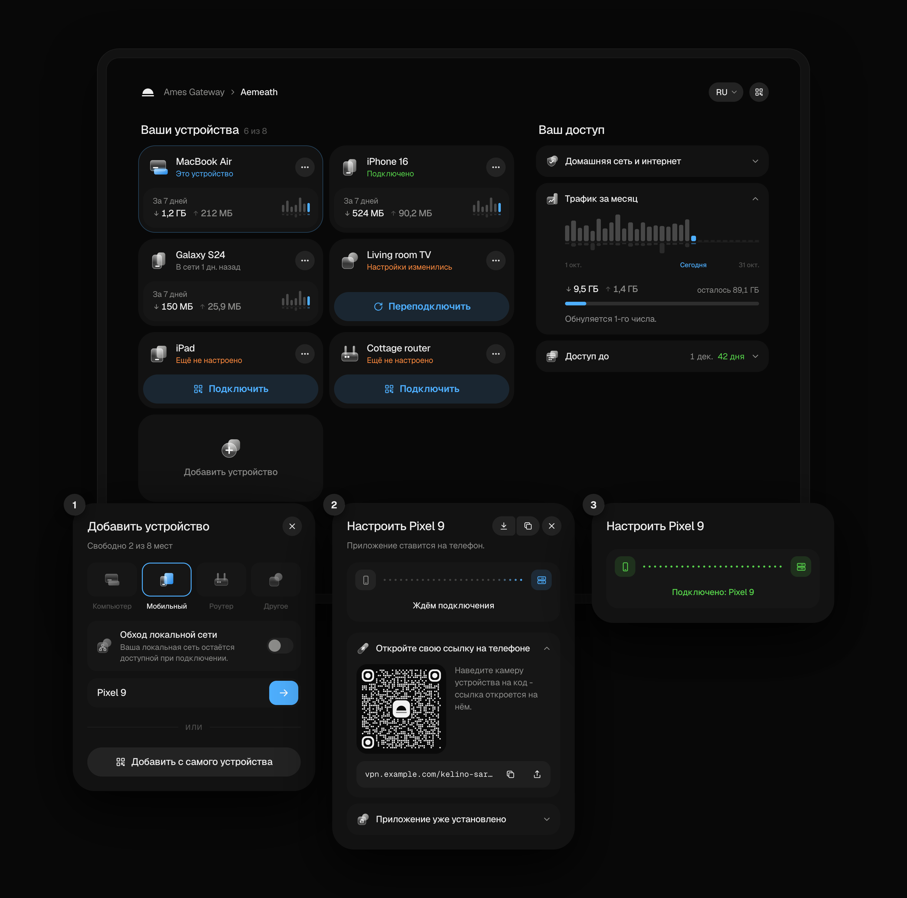
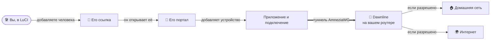
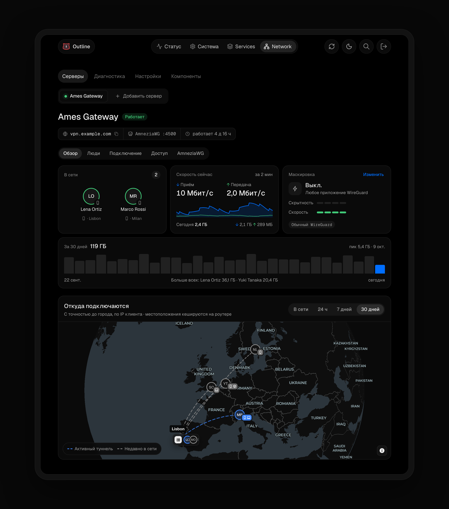
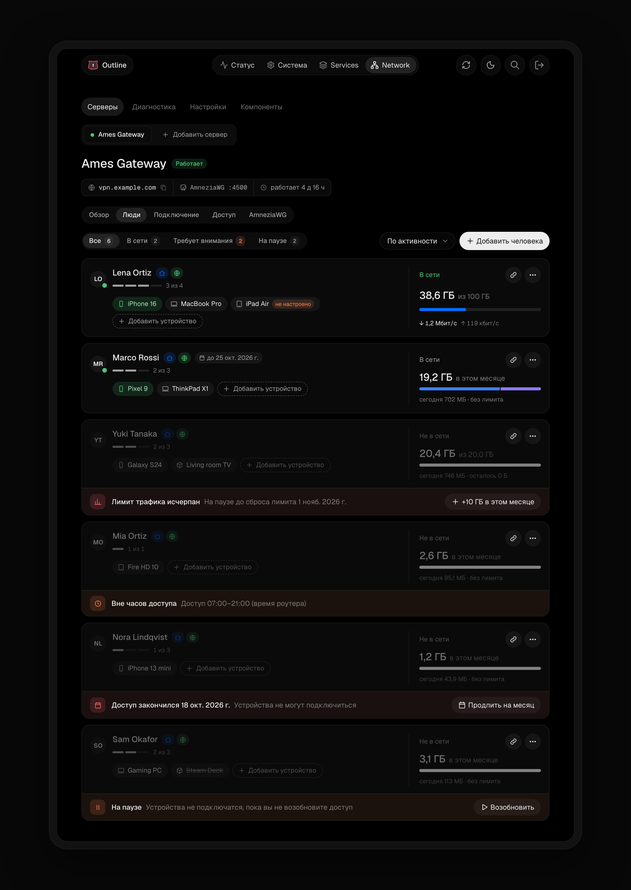
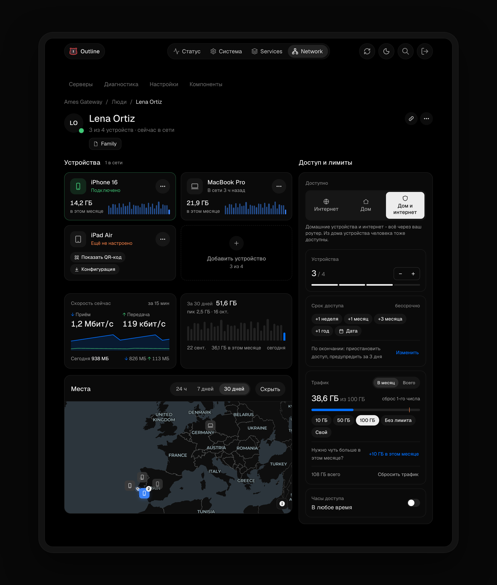

<div align="center">

<picture>
  <source media="(prefers-color-scheme: dark)" srcset="docs/assets/logo-dark.svg">
  
</picture>

<h1>Dawnline</h1>

**Ваш роутер на OpenWrt как личный VPN для тех, кого вы выберете.**

<a href="https://github.com/tickcount/luci-app-dawnline/releases/latest"><picture><source media="(prefers-color-scheme: dark)" srcset="https://shieldcn.dev/github/release/tickcount/luci-app-dawnline.svg?variant=secondary&font=geist&mode=dark"></picture></a>
<a href="https://github.com/tickcount/luci-app-dawnline/actions/workflows/ci.yml"><picture><source media="(prefers-color-scheme: dark)" srcset="https://shieldcn.dev/github/ci/tickcount/luci-app-dawnline.svg?variant=secondary&font=geist&mode=dark"></picture></a>
<a href="https://github.com/tickcount/luci-app-dawnline/releases"><picture><source media="(prefers-color-scheme: dark)" srcset="https://shieldcn.dev/github/downloads/tickcount/luci-app-dawnline.svg?variant=secondary&font=geist&mode=dark"></picture></a>
<a href="LICENSE"><picture><source media="(prefers-color-scheme: dark)" srcset="https://shieldcn.dev/github/license/tickcount/luci-app-dawnline.svg?variant=secondary&font=geist&mode=dark"></picture></a>
<br>
<a href="https://openwrt.org/"><picture><source media="(prefers-color-scheme: dark)" srcset="https://shieldcn.dev/badge/OpenWrt-24.10%20%C2%B7%20opkg.svg?variant=secondary&font=geist&logo=openwrt&mode=dark"></picture></a>
<a href="https://openwrt.org/"><picture><source media="(prefers-color-scheme: dark)" srcset="https://shieldcn.dev/badge/OpenWrt-25.12%20%C2%B7%20apk.svg?variant=secondary&font=geist&logo=openwrt&mode=dark"></picture></a>
<a href="https://docs.amnezia.org/"><picture><source media="(prefers-color-scheme: dark)" srcset="https://shieldcn.dev/badge/AmneziaWG-2.0%20%C2%B7%203.1.svg?variant=secondary&font=geist&logo=wireguard&mode=dark"></picture></a>

[**Быстрый старт**](#-быстрый-старт) &nbsp;·&nbsp; [**Демо**](https://dawnline-demo.vercel.app) &nbsp;·&nbsp; [Возможности](#-возможности) &nbsp;·&nbsp; [Как это работает](#-как-это-работает) &nbsp;·&nbsp; [Скриншоты](#-как-это-выглядит) &nbsp;·&nbsp; [Вопросы](#-вопросы-и-ответы) &nbsp;·&nbsp; [Разработка](#-разработка)

[English](README.md) &nbsp;·&nbsp; **Русский**

</div>

<br>

Dawnline запускает сервер [AmneziaWG] на вашем роутере с OpenWrt и даёт каждому,
кого вы пригласите, **личную ссылку**. По ней человек **сам добавляет свои
телефоны и компьютеры** и подключается через AmneziaVPN, AmneziaWG или WireGuard.
Вы решаете, **что ему доступно** (домашняя сеть, интернет или и то и другое), и
**на какой срок, сколько трафика и в какие часы**.

<p align="center">
  <a href="https://dawnline-demo.vercel.app"></a>
  <br>
  <sub>Личная страница человека: его устройства и доступ. Телефон добавляется в три шага, и страница видит, когда он подключился.
  <a href="https://dawnline-demo.vercel.app"><b>Попробуйте в демо</b></a>: ничего не устанавливается и никуда не подключается.</sub>
</p>

## 💡 Почему Dawnline?

Обычно, чтобы поделиться домашним VPN, приходится вручную делать файл
конфигурации, отправлять его в мессенджере и надеяться, что дальше он никуда не
уйдёт. Dawnline делает наоборот:

| | VPN вручную | С Dawnline |
|---|---|---|
| **Настройка устройства** | Вы делаете конфиг и отправляете его | Человек добавляет устройство сам по своей ссылке |
| **Кому что можно** | Всем одно и то же | Дом, интернет или и то и другое, для каждого своё |
| **Конец доступа** | Найти и удалить его пиры | Дата, лимит трафика или один клик |
| **Что происходит** | Читать `wg show` | Кто в сети, трафик, места, журнал |
| **Когда что-то ломается** | Узнаёте от людей | Автовосстановление замечает и чинит |

Это преемник [Liminal]: та же идея, перестроенная вокруг людей, а не пиров, с
личным порталом, лимитами, трафиком в реальном времени и современной админкой
в LuCI.

## 🚀 Быстрый старт

1. **Установите** на роутер (установщик спрашивает, прежде чем что-то менять):

   ```sh
   sh -c "$(wget -qO- https://raw.githubusercontent.com/tickcount/luci-app-dawnline/main/install.sh)"
   ```

2. **Настройте** в LuCI: <kbd>Network</kbd> › <kbd>Dawnline</kbd>, дальше по
   мастеру. Он предложит порт, публичный адрес и сети.
3. **Пригласите** человека: <kbd>Добавить человека</kbd>, затем отправьте ему
   ссылку или карточку приглашения с QR-кодом. Остальное он сделает сам.

> [!TIP]
> Если портал за Cloudflare, дайте ему порт, который Cloudflare проксирует:
> 2053, 2083, 2087, 2096 или 8443.

## ✨ Возможности

<table>
  <tr>
    <td width="50%" valign="top">
      <h3>🔗 Ссылка вместо аккаунта</h3>
      <p>Три слова, например <code>vpn.example.com/kamiro-telosu-bavine</code>. Ссылка и есть ключ: без регистрации и пароля, а новая ссылка сразу отключает старую.</p>
    </td>
    <td width="50%" valign="top">
      <h3>📱 Свои устройства</h3>
      <p>Люди сами добавляют, переименовывают и удаляют устройства в пределах лимита. При добавлении портал ведёт по шагам: нужное приложение, затем QR-код, ссылка, ключ или файл.</p>
    </td>
  </tr>
  <tr>
    <td valign="top">
      <h3>👥 Люди, а не пиры</h3>
      <p>Карточка на каждого человека: устройства, кто в сети, трафик, дата окончания и лимит. Фильтры по тем, кто требует внимания или на паузе.</p>
    </td>
    <td valign="top">
      <h3>🧭 Кому что доступно</h3>
      <p>Домашняя сеть, интернет или и то и другое; только часть домашних сетей или устройств (NAS, Home Assistant). Семья видит семью, гости видят гостей.</p>
    </td>
  </tr>
  <tr>
    <td valign="top">
      <h3>⏳ Лимиты</h3>
      <p>Даты окончания, лимит трафика на месяц или за всё время, часы доступа, кнопка паузы. Изменения применяются сразу и не обрывают подключения остальных.</p>
    </td>
    <td valign="top">
      <h3>🕶️ Маскировка</h3>
      <p>Пресеты, которые мешают распознать и заблокировать VPN-трафик, и что каждый из них требует от приложений.</p>
    </td>
  </tr>
  <tr>
    <td valign="top">
      <h3>🏠 Интернет как у домашних устройств</h3>
      <p>Включите, и устройства людей выйдут в интернет так же, как домашние: ваши прокси, фильтры рекламы и DNS сработают и для них. По умолчанию выключено: это стоит скорости.</p>
    </td>
    <td valign="top">
      <h3>🗺️ Обзор и места</h3>
      <p>Кто в сети и с чего, скорость сейчас, последние 30 дней и карта, откуда подключаются, с точностью до города.</p>
    </td>
  </tr>
  <tr>
    <td valign="top">
      <h3>🩺 Чинит себя сам</h3>
      <p>Проверки состояния с исправлением в один клик и автовосстановление, которое каждую минуту проверяет туннели, правила доступа и портал и чинит их.</p>
    </td>
    <td valign="top">
      <h3>📦 Обновления и резервные копии</h3>
      <p>Dawnline и AmneziaWG, собранный под вашу прошивку, в одном месте; ночные резервные копии, экспорт и импорт для переезда на другой роутер.</p>
    </td>
  </tr>
  <tr>
    <td valign="top">
      <h3>🌐 Английский и русский</h3>
      <p>Портал подстраивается под язык посетителя и переключается в шапке. Админка и сообщения роутера на русском с пакетом <code>luci-i18n-dawnline-ru</code>.</p>
    </td>
    <td valign="top"></td>
  </tr>
</table>

## 🧩 Как это работает



1. **Вы добавляете человека** в LuCI и выбираете, что ему доступно, лимит
   устройств, дату окончания или лимит трафика.
2. **Он открывает свою ссылку** на любом устройстве. Портал только его: там его
   устройства и его доступ; доступ и лимиты меняете только вы.
3. **Он добавляет устройство.** Портал подсказывает приложение для его системы и
   передаёт подключение; роутер выдаёт каждому устройству свои ключи.
4. **Устройство подключается** через сервер AmneziaWG на роутере, а Dawnline
   пропускает только то, что доступно этому человеку, считает его трафик и
   следит за лимитами.

## 📸 Как это выглядит

<p align="center">
  
  <br>
  <sub><b>Обзор</b>: кто в сети, скорость сейчас, последние 30 дней и карта, откуда подключаются.</sub>
</p>

<table>
  <tr>
    <td width="50%" valign="top">
      
      <p align="center"><sub><b>Люди</b>: в сети, доступ скоро закончится, сверх лимита, вне часов доступа, на паузе.</sub></p>
    </td>
    <td width="50%" valign="top">
      
      <p align="center"><sub><b>Человек</b>: его устройства, трафик, места и лимиты.</sub></p>
    </td>
  </tr>
</table>

## 📋 Требования

| | Что нужно Dawnline |
|---|---|
| **OpenWrt** | 24.10 (opkg, `.ipk`) или 25.12 (apk, `.apk`) |
| **AmneziaWG** | `kmod-amneziawg`, `amneziawg-tools`, `luci-proto-amneziawg`: если их нет, установщик поставит сборку для вашей прошивки |
| **Свободная флеш-память** | около 2 МБ |

## 📥 Установка

```sh
sh -c "$(wget -qO- https://raw.githubusercontent.com/tickcount/luci-app-dawnline/main/install.sh)"
```

Установщик проверяет прошивку, часы, свободное место и DNS, даёт выбрать релиз
(по умолчанию последний), показывает план и спрашивает, прежде чем что-то
менять. Он скачивает пакет для вашего менеджера пакетов, сверяет его с
`sha256sums.txt`, ставит AmneziaWG для вашей прошивки, если его нет, затем
ставит Dawnline (с русским переводом, если LuCI на русском) и проверяет, что
LuCI его видит.

> [!NOTE]
> Прежде чем что-то менять, он сохраняет `/etc/config/{dawnline,network,firewall,dhcp,uhttpd}`
> и состояние служб в `/etc/dawnline/installer-backups/` (хранятся три последние
> копии) и возвращает их, если какой-то шаг не удался. Пакеты не откатываются:
> чтобы вернуться к старому релизу, запустите установщик с `--tag`. Всё, что он
> делает, записывается в `/tmp/dawnline-install.log`.

<details>
<summary><b>Параметры установщика</b></summary>

<br>

С параметрами его нужно сначала скачать:

```sh
wget -O /tmp/dawnline-install.sh https://raw.githubusercontent.com/tickcount/luci-app-dawnline/main/install.sh
sh /tmp/dawnline-install.sh --dry-run             # всё проверить, ничего не менять
sh /tmp/dawnline-install.sh -y --tag 0.3.1        # конкретный релиз, без вопросов
sh /tmp/dawnline-install.sh --awg grey            # AmneziaWG от 2Grey
sh /tmp/dawnline-install.sh --lang ru             # с русским переводом админки
```

| Параметр | |
|---|---|
| `-y`, `--yes` | Без вопросов: последний релиз (или `--tag`) и рекомендуемые варианты |
| `-n`, `--dry-run` | Проверить систему, найти, скачать и проверить релиз; ничего не менять |
| `-v`, `--verbose` / `-q`, `--quiet` | Подробнее / только предупреждения и ошибки |
| `--tag X.Y.Z` | Конкретный релиз (`sh install.sh 0.3.1` тоже работает) |
| `--awg auto\|slava\|grey\|skip` | Откуда брать AmneziaWG, если его нет: [Slava-Shchipunov], затем [2Grey] (`auto`, по умолчанию), только один из них или вообще не ставить (потом можно в **Dawnline → Компоненты**). То же самое делает `DAWNLINE_AWG` |
| `--no-awg` | То же, что `--awg skip` |
| `--lang auto\|ru\|none` | Перевод админки, `luci-i18n-dawnline-<язык>`: `auto` (по умолчанию) ставит его, если LuCI настроен на этот язык или в нём стоит перевод LuCI на него; `none` не ставит. Уже установленный перевод всегда обновляется вместе с Dawnline. Позже: **Dawnline → Компоненты → Перевод**. То же самое делает `DAWNLINE_LANG` |

</details>

<details>
<summary><b>Если GitHub медленный или заблокирован</b></summary>

<br>

Установщик сам повторяет загрузки через `ghfast.top` и `gh-proxy.com`. Чтобы
скачать сам установщик через зеркало:

```sh
sh -c "$(wget -qO- https://cdn.jsdelivr.net/gh/tickcount/luci-app-dawnline@main/install.sh)"
sh -c "$(wget -qO- https://ghfast.top/https://raw.githubusercontent.com/tickcount/luci-app-dawnline/main/install.sh)"
```

</details>

<details>
<summary><b>Установка вручную</b></summary>

<br>

Из [релиза](https://github.com/tickcount/luci-app-dawnline/releases):

```sh
opkg update && opkg install ./luci-app-dawnline-0.1.0.ipk                 # OpenWrt 24.10
apk update && apk add --allow-untrusted ./luci-app-dawnline-0.1.0.apk     # OpenWrt 25.12
```

Русский перевод: `luci-i18n-dawnline-ru-<версия>` из того же релиза, ставится
так же, после приложения (затем `/etc/init.d/uhttpd restart`).

</details>

**Обновление**: в <kbd>Dawnline</kbd> › <kbd>Компоненты</kbd> или повторным
запуском установщика. Настройки, ключи и история сохраняются, перед обновлением
делается резервная копия.

### Удаление

```sh
sh -c "$(wget -qO- https://raw.githubusercontent.com/tickcount/luci-app-dawnline/main/uninstall.sh)"
```

Деинсталлятор сохраняет конфигурацию в `/etc/dawnline/backups`, запускает
удаление средствами самого Dawnline (как <kbd>Настройки</kbd> › <kbd>Удалить
Dawnline с этого роутера</kbd>), удаляет пакет и подчищает остатки. После
повторной установки Dawnline восстановите копию в <kbd>Настройки</kbd> ›
<kbd>Резервные копии</kbd>.

> [!IMPORTANT]
> AmneziaWG остаётся установленным: его могут использовать другие туннели.
> Чтобы удалить и его, добавьте `--remove-awg`.

<details>
<summary><b>Параметры деинсталлятора</b></summary>

<br>

С параметрами его нужно сначала скачать:

```sh
wget -O /tmp/dawnline-uninstall.sh https://raw.githubusercontent.com/tickcount/luci-app-dawnline/main/uninstall.sh
sh /tmp/dawnline-uninstall.sh --dry-run
```

| Параметр | |
|---|---|
| `-y`, `--yes` | Не спрашивать подтверждения |
| `-p`, `--purge` | Удалить также конфигурацию, ключи, историю и все резервные копии (`/etc/config/dawnline`, `/etc/dawnline`); копия не делается |
| `--remove-awg` | Удалить также AmneziaWG, если его не использует другой интерфейс (`--keep-awg`, по умолчанию, оставляет его) |
| `-n`, `--dry-run` | Показать, что будет удалено; ничего не менять |

Вручную: <kbd>Настройки</kbd> › <kbd>Удалить Dawnline с этого роутера</kbd>
(резервная копия сохраняется), затем `opkg remove luci-app-dawnline` или
`apk del luci-app-dawnline`.

</details>

## ❓ Вопросы и ответы

<details>
<summary><b>Какими приложениями пользуются люди?</b></summary>

<br>

AmneziaVPN или AmneziaWG на телефонах и компьютерах, а обычный WireGuard, если
маскировка выключена. Портал показывает каждому приложение для его системы и
как добавить в нём подключение.

</details>

<details>
<summary><b>Что делать, если человек потерял ссылку?</b></summary>

<br>

Создайте новую на его странице. Старая ссылка сразу перестанет работать; его
устройства продолжат работать, если не отметить те, что нужно удалить вместе с
ней.

</details>

<details>
<summary><b>Затрагивает ли он остальной роутер?</b></summary>

<br>

Только то, что создал сам, и `dawnline teardown` убирает всё это. Полный список:
[Что Dawnline меняет на роутере](#-что-dawnline-меняет-на-роутере).

</details>

<details>
<summary><b>Как переехать на другой роутер?</b></summary>

<br>

<kbd>Экспорт JSON</kbd> в <kbd>Настройки</kbd> › <kbd>Резервные копии</kbd> на
старом роутере, установите Dawnline на новый и импортируйте там этот файл.

</details>

<details>
<summary><b>Откуда берутся места на карте?</b></summary>

<br>

Из адреса, с которого подключается устройство: город определяется по нему и
кешируется на роутере. Это можно выключить в <kbd>Настройках</kbd>.

</details>

## 🧾 Что Dawnline меняет на роутере

Только то, что создал сам: сетевые интерфейсы с меткой `_dawnline`, секции
межсетевого экрана `dawnline_*`, таблицу nft `inet dawnline`, `/tmp/hosts/dawnline`,
сетевое пространство имён `dawnline` с двумя veth-связями (`dlx0` и `dll0`,
вторая подключена к мосту LAN и требует `kmod-veth`), правила маршрутизации для
интерфейсов туннелей с одной таблицей маршрутизации, второй экземпляр dnsmasq на
порту 5354 (`/var/etc/dawnline-dns.conf`), строку cron для проверки пульса
агента и, пока портал включён, экземпляр uhttpd для него. `dawnline teardown`
убирает всё это.

Данные хранятся в `/etc/config/dawnline` (права 0600, там приватные ключи) и в
`/etc/dawnline/` (трафик, события, выданные конфигурации, резервные копии).
Текущие счётчики живут в `/var/run/dawnline` и записываются во флеш-память не
чаще раза в час. Изменения доступа доходят до туннеля через `awg syncconf`, без
перезапуска интерфейса; `dawnline log` на роутере показывает журнал служб.

## 🧰 Разработка

```
package/luci-app-dawnline/
  root/usr/share/ucode/dawnline/   библиотека на ucode: модель (core), AmneziaWG (awg), apply, live,
                                   ops, view, loop, portal
  root/usr/share/rpcd/ucode/       объект RPC luci.dawnline
  root/usr/libexec/dawnline/       агент (трафик, лимиты, присутствие) и апдейтер
  root/usr/share/dawnline/portal/  CGI-обёртка портала и его (минифицированные) файлы
  root/usr/bin/dawnline            командная строка (`dawnline help`)
  htdocs/                          представления LuCI и сгенерированный модуль dawnline/app.js
  po/                              каталог строк админки (dawnline.pot, ru/dawnline.po)
web/                               исходники админки и портала на TypeScript
web/i18n/                          инструменты каталогов: сбор строк, слияние .po, сборка .lmo
build/Dockerfile                   сборка пакетов в OpenWrt SDK
scripts/                           скрипты сборки, деплоя и проверок
```

```sh
cd web
npm ci
npm run format        # Prettier
npm run ci            # форматирование, типы, каталоги, тесты, минифицированные бандлы
npm run i18n          # собрать новые строки в каталоги (затем перевести их в ru.po)

scripts/lint-ucode.py                    # статические проверки ucode
scripts/check-ucode.sh root@router       # скомпилировать все файлы ucode на роутере
scripts/deploy.sh root@router            # поставить рабочую копию (сначала сохраняет конфиги)
scripts/build-packages.sh all            # .ipk и .apk в OpenWrt SDK в Docker
scripts/capture-screenshots.mjs --demo   # скриншоты админки для README с роутера, с демо-людьми вместо настоящих
scripts/capture-portal.mjs               # скриншоты портала для README из его демо, на английском и русском
scripts/frame-screenshots.py             # оформить их для README
```

Бандлы и каталоги лежат в репозитории: CI падает, если они устарели или строка
не переведена (`rules/i18n.md`). Тег `vX.Y.Z` (совпадающий с `PKG_VERSION`)
собирает пакеты и переводы в OpenWrt SDK и публикует релиз с `sha256sums.txt`.

---

<div align="center">
<sub>Сделано для OpenWrt · <a href="LICENSE">лицензия MIT</a> · <a href="#readme">Наверх ↑</a></sub>
</div>

[AmneziaWG]: https://docs.amnezia.org/
[Liminal]: https://github.com/tickcount/openwrt-liminal
[Slava-Shchipunov]: https://github.com/Slava-Shchipunov/awg-openwrt
[2Grey]: https://github.com/2Grey/awg-openwrt
